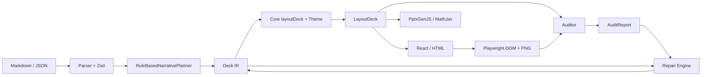

# RenderKit 2D v0.1 架构

RenderKit 把内容理解、视觉排版、具体输出、验证与修复分为独立阶段。共享 IR 是阶段之间的数据协议。v0.1 使用单个 TypeScript 工程组织模块，避免为了目录形式建立空 npm 包。

## 数据流



文件输出和进程生命周期由 CLI 管理。各渲染器不读取任意输入文件，也不直接修改原始文稿。

## 模块依赖

| 模块 | 输入 | 输出 | 不负责的工作 |
| --- | --- | --- | --- |
| `schema` | `unknown` | 验证后的 `Deck` | 排版、文件 I/O、内容事实判断 |
| `narrative` | 字符串 / `Deck` | 内容 IR / 带契约的 Deck | 调用付费模型、编造证据、绘图 |
| `design-system` | 主题 ID | `Theme` | 业务数据、实验值 |
| `core` | `Deck` | `LayoutDeck` | DOM、PPTX API、文件写入 |
| `renderer-web` | `LayoutDeck` | React 节点 / HTML | 修改内容或规划顺序 |
| `renderer-pptx` | `LayoutDeck` | PPTX 文件 | 判断实验真实性、自动删内容 |
| `auditor` | 布局 + 可选 DOM 观测 | `AuditReport` | 以质量分数证明结论 |
| `cli` | 命令参数 + 本地文件 | 版本、报告、产物 | 绕过 Schema、执行用户脚本 |

依赖方向应从应用层指向这些模块，不能让 `schema` 或 `core` 反向依赖 CLI。浏览器组件只导入可在浏览器执行的入口；Node 的 `fs`、字体文件读取和 PPTX 输出保留在服务器入口。

## 共享 IR 边界

`Deck` 是内容的事实来源，包含语义页型、文字、公式、图表数值、架构边、来源、保留约束、主题选择和少量显式布局覆盖。通过 Zod 验证后才能进入规划与排版。

`RuleBasedNarrativePlanner.plan(deck)` 为页面建立受众、目的、主信息、论点、证据、视觉表达、演讲备注和验收标准。契约归属于 `slide.id`。规划可以选择表达方式，但不能创造不存在的实验结果；新模型适配器也必须遵守这一边界。

`LayoutDeck` 是派生结果：

```ts
interface LayoutDeck {
  deck: Deck;
  theme: Theme;
  slides: LayoutSlide[];
}
interface LayoutSlide {
  id: string;
  title: string;
  width: number;
  height: number;
  elements: LayoutElement[];
  notes: string;
  source: Slide;
}
```

每个 `LayoutElement` 包含稳定 `id`、`slideId`、`role`、`kind`、逻辑像素矩形、字号、颜色及源 `block`。稳定 ID 是审计定位、局部修复和回归比较的基础。不要将像素坐标回写为内容事实；只有显式修复时才生成新的布局覆盖。

## Renderer Adapter 边界

通用适配器契约位于 `packages/core/src/types.ts`：

```ts
interface RendererAdapter<T> {
  render(layout: LayoutDeck): T | Promise<T>;
}
```

当前函数入口：`renderDeckHtml(layout): string`，以及 `renderPptx(layout, outputPath): Promise<void>`。它们共享 `LayoutDeck`，允许对具体格式做合理布局换算。

Web 使用 1280 × 720 逻辑画布、CSS 和 SVG，公式为 KaTeX。Node HTML 入口嵌入本地 KaTeX 样式与字体，浏览器不需要访问 CDN。React 对文字进行转义，数学渲染必须保持不信任用户命令的配置。

PPTX 将逻辑像素换算为幻灯片英寸与文本磅值。文字、表格、基础形状、流程和架构连接、图表优先输出原生 Office 对象；公式用 MathJax SVG。公式 SVG 和位图不是原生可编辑公式或图形。主题颜色和数据语义应保持一致，不能要求两种输出逐像素相同。

新增适配器必须证明：不改变数值和公式、必需 block 不丢失、输出格式可解析，并明确可编辑性及渲染能力限制。

## Auditor 边界

`auditLayout(layout, observations?)` 检查计划布局，并可合并 `captureBrowser(htmlPath, outputDir)` 返回的真实浏览器观测。没有浏览器观测时，文字尺寸检查属于估算；不能声称已验证 DOM 排版。

每条问题包含 `issueId`, `elementId`, `slideId`, `category`, `severity`, `description`, `evidence`, `recommendedFix`, `status`。证据保留相关矩形、尺寸、对比度或缺失 ID 等可复查信息。

硬约束包括越界、非预期重叠、文字溢出、字号区间、对比度、必需内容缺失，以及可检查的图像比例。软指标覆盖对齐、留白、密度、层级、颜色与均衡，独立于内容事实正确性。文字覆盖其背景是有意重叠，应利用元素角色、容器关系或显式重叠许可处理。

结构检查只能判断 PPTX ZIP/XML 是否合理，不能证明 PowerPoint 最终显示无溢出。真实 PPTX 视觉验证需要独立的 Office / LibreOffice 渲染适配器，不能用 Web 截图冒充。

## Repair Engine 边界

`repairDeck(deck, {maxIterations, elementId?})` 返回新的 Deck、最终报告、迭代次数、历史报告与修改记录。输入 Deck 保持不变。修复最多运行指定次数，遇到不能安全修复的问题保留诊断，不把问题状态伪装成通过。

可修改的是布局位置、尺寸、间距、对齐和安全区间内字号。局部模式只针对指定稳定 ID。拆页若实现，必须保存内容、来源与保留约束，并提供 ID 映射；尚未覆盖的复杂分页应报告为待人工处理。

禁止改变实验数值、删除必需内容、修改公式、重写结论或来源来降低审计问题数。回归测试对内容字段进行比较，而不只检查最终分数。将来接入 LLM 修复时也只能提出受 Schema 和数据保全约束验证的补丁。

## CLI、产物和生命周期

`build` 生成 `index.html`、`deck.pptx`（按 target）、`planned.json`、`audit-report.json` 和 `manifest.json`。`--screenshots` 额外生成 `screenshots/` PNG，并加入浏览器观测。源文件以 `source-<sha12>.<ext>` 保存。

`repair` 生成 `repaired.json`、`repair-history.json`、重新渲染的 `index.html` 和 `audit-report.json`，并保存源文件快照。它不直接覆盖输入文件。再次写入同一输出目录前，旧产物移入 `versions/<时间与唯一标识>/`。原始输入按哈希保存，输出路径与输入冲突时拒绝执行。`repair --browser` 重新渲染后用 Chromium 复查，新增未解决问题保留为 manual-review，不声称自动修复已成功。

`preview` 启动本地 HTTP 服务；进程需要在新任务或机器重启后重新启动。HTML、PPTX、JSON、PNG 是文件资产，可以保留。云环境的运行进程不属于已持久化配置。

## 后续迭代的验证门槛

1. 改 Schema：增加非法输入和版本迁移测试，确认双渲染器消费同一份数据。
2. 改布局：运行固定样本的 DOM 审计、截图和局部修复回归。
3. 改 PPTX：检查 ZIP/XML、图表源值和原生对象类型，再在目标 Office 中渲染复查。
4. 改修复：证明输入不变、内容字段不变、无关组件不变，并报告剩余问题。
5. 加模型适配器：默认关闭网络；显式配置调用；保存建议与采纳结果，禁止把模型输出直接当可信 IR。
